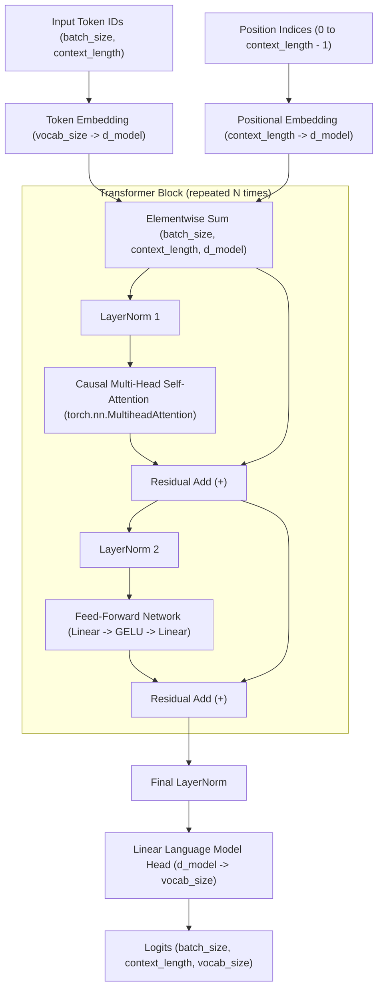

# From ChatGPT to a Tiny GPT: How Language Models Work

An educational project implementing a small decoder-only, autoregressive GPT-style language model from scratch using Python and PyTorch for the iCog Labs assignment.

---

## 1. Project Purpose & Learning Goals

The primary goal of this project is to demystify generative autoregressive language models (such as GPT-2 and ChatGPT) by constructing the underlying architecture, data pipeline, training loop, and inference engine from scratch:

- **Built From Scratch with Random Initialization:** We do not load pretrained GPT weights (such as standard OpenAI GPT-2 weights). The Transformer architecture is implemented directly in PyTorch, initialized randomly, and trained on a selected text corpus.
- **Conceptual Grounding:** Demonstrates hands-on understanding of tokenization, positional embeddings, causal multi-head self-attention, residual connections, layer normalization, autoregressive next-token prediction, cross-entropy loss, checkpointing, and model serving.
- **Realistic Output Expectations:** This model is designed for educational purposes with a compact parameter footprint. Because it is trained from scratch with randomly initialized weights on a modest dataset and compute budget, it will learn basic linguistic patterns and syntax, but it will **not** produce ChatGPT-level fluency or general reasoning. Output quality depends directly on dataset size, model capacity, training duration, and available compute.

---

## 2. Planned Model Architecture

The planned architecture is a small decoder-only Transformer based on the GPT design:



### Key Architectural Components

1. **Token Embeddings:** Maps input token IDs from the GPT-2 vocabulary ($V = 50,257$) to a dense embedding space of dimension $d_{\text{model}}$ (e.g., 64). This requires $V \times d_{\text{model}} = 50,257 \times 64 \approx 3.22\text{M}$ learnable parameters.
2. **Positional Embeddings:** Learnable positional vectors representing token positions up to the maximum context length $T$ (e.g., 64), contributing $T \times d_{\text{model}} = 64 \times 64 = 4,096$ parameters.
3. **Causal Multi-Head Self-Attention:** Implemented using PyTorch's `torch.nn.MultiheadAttention` (`batch_first=True`) coupled with a strict upper-triangular causal mask (`attn_mask`). The causal mask ensures position $i$ can only attend to positions $j \le i$, preventing tokens from attending to subsequent tokens.
4. **Position-wise Feed-Forward Network (FFN / MLP):** Expands the hidden dimension to $4 \times d_{\text{model}}$, applies a non-linear activation (GELU), and projects back to $d_{\text{model}}$ ($\approx 33\text{k}$ parameters per block).
5. **Pre-Layer Normalization & Residual Connections:** Uses a pre-LN design (`x = x + Sublayer(LayerNorm(x))`) for numerical stability and effective gradient propagation through layers.
6. **Language Model Output Head:** Linear projection from $d_{\text{model}}$ to $V$ ($50,257$), producing raw logits of shape `(batch_size, context_length, vocab_size)`. In an untied model, this projection adds another $d_{\text{model}} \times V = 64 \times 50,257 \approx 3.22\text{M}$ parameters.

### Next-Token Target Shifting

During training, autoregressive language models predict the immediate next token for every position simultaneously in a single forward pass:
- Given a raw tokenized sequence of length $T + 1$: $(t_0, t_1, t_2, \dots, t_T)$
- **Input sequence ($x$):** $(t_0, t_1, \dots, t_{T-1})$ with shape `(batch_size, context_length)`
- **Target sequence ($y$):** $(t_1, t_2, \dots, t_T)$ with shape `(batch_size, context_length)`
- At position $i$, the model receives $x_i = t_i$ (with causal visibility of preceding tokens $t_0, \dots, t_i$) and calculates the cross-entropy loss against target $y_i = t_{i+1}$.

### Parameter Distribution & Weight-Tying Decision

- **Untied Baseline (Assignment Starting Point):** The token embedding table ($\approx 3.22\text{M}$) and LM output head ($\approx 3.22\text{M}$) together account for $\approx 6.43\text{M}$ parameters, dominating a 1-block Transformer body ($\approx 50\text{k}$ parameters).
- **Weight Tying (Optional Enhancement):** Weight tying reuses the input embedding weights for the output projection (`lm_head.weight = token_embeddings.weight`). While weight tying cuts total parameters almost in half and stabilizes training, we strictly implement the untied architecture first to fulfill the core baseline requirements before exploring weight tying as a future optimization.


---

## 3. Technology Stack & Design Decisions

| Category | Technology | Rationale | Status |
| :--- | :--- | :--- | :--- |
| **Language** | Python | Standard language for modern deep learning and PyTorch development. | Configured |
| **Deep Learning** | PyTorch (`torch`) | Tensor manipulation, autograd, `nn.Module` abstractions, and Adam optimizer. | Dependency specified |
| **Tokenizer** | `tiktoken` | Implements OpenAI's GPT-2 Byte-Pair Encoding (BPE) with 50,257 tokens, as required by Task 1. | Dependency specified |
| **Dataset Loading** | Hugging Face `datasets` | Standardized access to text corpora without custom scraping. | Dependency specified |
| **Testing** | `pytest` | Automated assertions for token shift invariants, tensor shapes, and causal masking. | Dependency specified |
| **Backend API** | FastAPI + Uvicorn | High-performance asynchronous REST API for serving model text generation. | Planned (Optional Bonus) |
| **Schema Validation** | Pydantic | Typed request and response models for the generation endpoint. | Planned (Optional Bonus) |
| **Frontend UI** | React + Vite | Clean single-page chat interface built with JavaScript, JSX, and CSS. | Planned (Optional Bonus) |

---

## 4. Repository Structure

The following tree represents the complete project architecture:

```text
icog-gpt-model/
├── src/
│   ├── __init__.py           # [Implemented] Source package root
│   ├── data/
│   │   ├── __init__.py       # [Implemented] Data package initializer
│   │   ├── tokenizer.py      # [Implemented] tiktoken wrapper, encode/decode assertions
│   │   └── dataset.py        # [Implemented] Dataset, chunking, shifted targets (x, y)
│   ├── model/
│   │   ├── __init__.py       # [Implemented] Model package initializer
│   │   ├── config.py         # [Implemented] GPTConfig dataclass (hyperparameters)
│   │   ├── attention.py      # [Implemented] Causal self-attention layer
│   │   ├── feed_forward.py   # [Implemented] Feed-forward MLP network
│   │   ├── block.py          # [Implemented] Transformer decoder block
│   │   └── gpt.py            # [Implemented] Full GPT model with LM head
│   ├── training/
│   │   ├── __init__.py       # [Implemented] Training package initializer
│   │   └── trainer.py        # [Implemented] Training loop, loss tracking, checkpoint saving
│   └── generation/
│       ├── __init__.py       # [Implemented] Generation package initializer
│       └── generate.py       # [Implemented] Autoregressive decoding and checkpoint loader
├── tests/
│   ├── __init__.py           # [Implemented] Test package initializer
│   ├── test_data.py          # [Implemented] Tests for tokenization, target shifts, and shapes
│   ├── test_model.py         # [Implemented] Tests for forward pass shapes and causal mask
│   ├── test_training.py      # [Implemented] Tests for loss calculation, optimization, and evaluation
│   ├── test_generation.py    # [Implemented] Tests for autoregressive greedy decoding, backend service
│   └── test_backend.py       # [Implemented] Tests for FastAPI endpoint using TestClient and mocks
├── checkpoints/
│   ├── .gitkeep              # [Implemented] Keeps folder in git; binary weights are ignored
│   ├── tiny_gpt.pt           # [Generated] Trained checkpoint from verification run
│   ├── wikitext2_smoke.pt    # [Generated] 15-step CPU smoke-test checkpoint
│   └── tiny_gpt_wikitext2_60k_best.pt  # [Verified] 60k-step trained checkpoint from Kaggle
├── backend/
│   ├── __init__.py           # [Implemented] Backend package initializer
│   ├── requirements.txt      # [Implemented] FastAPI & Uvicorn dependencies
│   ├── main.py               # [Implemented] FastAPI application with POST /generate
│   ├── schemas.py            # [Implemented] Pydantic request/response schemas
│   └── service.py            # [Implemented] Model loader & inference service
├── frontend/
│   ├── package.json          # [Implemented] React 18 & Vite dependencies
│   ├── vite.config.js        # [Implemented] Vite development server config
│   ├── index.html            # [Implemented] HTML template with Google Fonts
│   ├── .env.example          # [Implemented] Backend API URL template
│   ├── README.md             # [Implemented] Dedicated frontend documentation
│   └── src/
│       ├── main.jsx          # [Implemented] React DOM entry point
│       ├── App.jsx           # [Implemented] Single-page UI with prompt and controls
│       ├── App.css           # [Implemented] Responsive stylesheet (light/indigo/dark output)
│       └── api.js            # [Implemented] Fetch client for POST /generate
├── README.md                 # [Implemented] Project documentation
├── requirements.txt          # [Implemented] Core dependencies for model, data, and training
├── .gitignore                # [Implemented] Excludes caches, venv, and large checkpoints
└── LICENSE                   # [Implemented] MIT License
```

---

## 5. Development Environment Setup

Local development and tests are intended to run on CPU on your local computer. GPU compute is reserved for Google Colab training.

### Prerequisites
- **Recommended Python:** Python 3.11 or 3.12 is strongly recommended for this project. While Python 3.13 is supported in recent PyTorch releases (2.5+), Python 3.11 and 3.12 offer the most mature, reliable pre-compiled binary wheel support across data dependencies (`datasets`, `pyarrow`, and `tiktoken`) on Windows.
- **Git** installed.

### Step 1: Create a Virtual Environment (Windows PowerShell)

In your VS Code terminal, navigate to the repository directory and create a virtual environment:

```powershell
# Navigate into the repository directory
cd C:\Users\hp\Documents\Icog-gpt-model\icog-gpt-model

# Create a virtual environment named .venv
python -m venv .venv
```

### Step 2: Activate the Virtual Environment

```powershell
# Activate in PowerShell
.\.venv\Scripts\Activate.ps1

# (Note: If PowerShell displays an execution policy restriction, run once:
# Set-ExecutionPolicy -ExecutionPolicy RemoteSigned -Scope CurrentUser)
```

### Step 3: Install Core Dependencies

```powershell
python -m pip install --upgrade pip
pip install -r requirements.txt
```

### Step 4: Verify Environment Installation

Execute this Python one-liner to verify that the core dependencies and tokenizer are accessible:

```powershell
python -c "import torch, tiktoken, datasets; print('PyTorch:', torch.__version__); print('Device:', 'cuda' if torch.cuda.is_available() else 'cpu'); enc = tiktoken.get_encoding('gpt2'); print('Vocab size:', enc.n_vocab)"
```

**Expected output:**
- PyTorch version displayed (e.g. `2.5.x` or `2.6.x`).
- Device: `cpu`.
- Vocab size: `50257`.

---

## 6. How Tests, Training, and Inference Run

Tasks 1, 2, and 3 are fully implemented, verified, and accompanied by offline automated tests.

### Running the Tokenizer Demonstration (5 Sentences)
To run the assignment-required demonstration of the GPT-2 tokenizer with five example sentences, token IDs, decoded text, and an explanation of token IDs as categorical vocabulary indices:

```powershell
python -m src.data.tokenizer
```

---

### Running the Test Suite (49 Tests)
All 49 unit tests in `tests/` run completely offline without downloading datasets or network access:

```powershell
pytest -v
```

**Verification result:**
```text
============================= 49 passed in 10.98s ==============================
- tests/test_data.py: 20 passed (5-sentence demo, tokenization roundtrip, WikiText header parsing, (x, y) target shift, EOT placement, split isolation)
- tests/test_model.py: 14 passed (config bounds, initialization, torch.nn.MultiheadAttention forward shapes, causal invariance, backpropagation)
- tests/test_training.py: 9 passed (Adam optimizer, loss reshaping, gradient updates, evaluation mode, parameter non-mutation in eval, checkpoint roundtrip)
- tests/test_generation.py: 6 passed (greedy decoding, context-length cropping, empty prompts, standalone inference)
```

---

### Running the Real-Data WikiText-2 Smoke Test (CPU)
A fast, real-data smoke test verifying the data loader, `torch.nn.MultiheadAttention` architecture, and `torch.optim.Adam` optimizer on actual WikiText-2 data (`Salesforce/wikitext`, `wikitext-2-raw-v1`) without starting full training:

```powershell
python -m src.training.trainer --epochs 1 --batch_size 2 --context_length 32 --device cpu --eval_interval 5 --max_train_steps 15 --max_val_batches 10 --checkpoint_path checkpoints/wikitext2_smoke.pt
```

**Actual Smoke-Test Output on Real WikiText-2:**
```text
Loading WikiText-2 dataset...
Extracting and tokenizing train documents...
Extracting and tokenizing validation documents...
Loaded 74,355 training samples and 7,689 validation samples.
--- Starting Training on CPU ---
Model parameters: 6,535,040 (non-embedding: 3,316,544)
Configuration: layers=2, heads=4, d_model=64, context=32
Epoch 1/1 | Step 5 | Train Loss: 10.7878 | Perplexity: 48427.25
  --> [IMPROVEMENT] Val Loss: 10.7843 | Checkpoint saved: checkpoints/wikitext2_smoke.pt
Epoch 1/1 | Step 10 | Train Loss: 10.7666 | Perplexity: 47409.54
  --> [IMPROVEMENT] Val Loss: 10.7163 | Checkpoint saved: checkpoints/wikitext2_smoke.pt
Epoch 1/1 | Step 15 | Train Loss: 10.6820 | Perplexity: 43562.65
  --> [IMPROVEMENT] Val Loss: 10.6388 | Checkpoint saved: checkpoints/wikitext2_smoke.pt
--- Training Finished in 1.70s across 15 steps ---
```

---

### Standalone Inference from Checkpoint (In a Separate Process)
You can generate text in a completely separate Python process by loading the smoke test checkpoint without retraining:

```powershell
python -m src.generation.generate --checkpoint checkpoints/wikitext2_smoke.pt --prompt "The history of" --max_new_tokens 20 --device cpu
```

**Actual Output from 15-step Real WikiText-2 Checkpoint:**
```text
Loading checkpoint from 'checkpoints/wikitext2_smoke.pt' onto CPU...
Model loaded: 6,535,040 parameters (layer=2, heads=4, d_model=64).
Checkpoint metadata: epoch=1, step=15, val_loss=10.6388

--- Generating Text ---
Prompt: 'The history of'
Requested new tokens: 20
----------------------------------------
Result:
The history of the the the the the the the the the the and the the the the the the the the the
----------------------------------------
```
*(Note: At step 15, the model has only barely begun optimizing away from random uniform initialization, with loss dropping from ~10.82 toward 10.63, naturally starting to predict the most frequent English corpus tokens "the" and "and".)*

---

### Prepared Full Training Command (Do Not Run Automatically)
The exact, verified command for running full training on the complete WikiText-2 dataset:

**On Local CPU (Estimated 2-4 hours):**
```powershell
python -m src.training.trainer --epochs 3 --batch_size 16 --context_length 64 --device cpu --eval_interval 200 --checkpoint_path checkpoints/wikitext2_full.pt
```

**On Google Colab GPU (Estimated 5-10 minutes on T4):**
```bash
python -m src.training.trainer --epochs 5 --batch_size 32 --context_length 64 --device cuda --eval_interval 200 --checkpoint_path checkpoints/wikitext2_full.pt
```

---

## 7. Task 3 Implementation Details

Task 3 brings the data pipeline (Task 1) and decoder-only Transformer architecture (Task 2) together into an end-to-end training and inference system.

### A. Training Loop & Cross-Entropy Loss
- **Loss Computation (`compute_loss`):**
  Given model logits of shape `(B, T, vocab_size)` and targets `(B, T)`, the tensors are reshaped to `(B * T, vocab_size)` and `(B * T,)` respectively before passing into `torch.nn.functional.cross_entropy`. This calculates next-token prediction loss simultaneously across all sequence positions.
- **Optimization Step (`train_one_step`):**
  1. `model.train()` activates dropout.
  2. `optimizer.zero_grad()` clears old gradients.
  3. `logits = model(x)` executes the forward pass.
  4. `loss = compute_loss(logits, y)` computes the cross-entropy loss.
  5. `loss.backward()` calculates gradients via autograd.
  6. `torch.nn.utils.clip_grad_norm_(model.parameters(), max_norm=1.0)` clips gradient norms to prevent exploding gradients.
  7. `optimizer.step()` updates trainable parameters using `torch.optim.Adam` (learning rate $10^{-3}$).
- **Random Initialization:** Training begins strictly from the model's random Gaussian initialization ($\mathcal{N}(0, 0.02^2)$). No pretrained GPT-2 weights are loaded.

### B. Validation Process & Overfitting Detection
- **Validation Evaluation (`evaluate`):**
  - Switches the model to evaluation mode (`model.eval()`), disabling dropout.
  - Wraps the loop in `with torch.no_grad():` to disable PyTorch's autograd engine and avoid accumulating computational graphs in RAM.
  - Iterates through validation batches without updating model weights or accumulating gradients.
  - Restores `model.train()` mode before returning control to the training loop.
- **Training Loss vs. Validation Loss:**
  - **Training Loss:** Measures how well the model predicts next tokens on data it is currently optimizing on.
  - **Validation Loss:** Measures how well the model predicts next tokens on unseen held-out text.
  - **Overfitting Diagnostics:**
    - *Underfitting:* Both training loss and validation loss remain high and decrease together slowly.
    - *Healthy Convergence:* Training loss decreases steadily, and validation loss decreases alongside it.
    - *Overfitting:* Training loss continues to drop toward zero, while validation loss plateaus and begins to rise. This indicates the model is memorizing training sequences rather than learning general linguistic syntax.
- **Selective Checkpointing:** The trainer tracks `best_val_loss`. Only validation improvements trigger checkpoint writes, ensuring a worse checkpoint never overwrites a better one.

### C. Autoregressive Text Generation (`generate_text`)
- **Greedy Decoding:**
  1. The user's prompt string is encoded into token IDs using `GPT2Tokenizer.encode()`. If the prompt is empty or whitespace, generation starts unconditionally from the `<|endoftext|>` token (`50256`).
  2. In evaluation mode (`model.eval()`) under `torch.no_grad()`, the sequence is fed to `model(idx)`.
  3. If the sequence length exceeds `context_length`, it is dynamically cropped to the most recent `context_length` tokens (`idx[:, -context_length:]`).
  4. The logits at the final position `logits[:, -1, :]` are extracted, and greedy selection picks the token with the highest predicted score: `next_token = torch.argmax(logits[:, -1, :], dim=-1)`.
  5. The chosen token is appended to the sequence and the process repeats until `max_new_tokens` are produced.
  6. The complete token list is decoded back into human-readable text via `GPT2Tokenizer.decode()`.

---

## 8. Training Results, Analysis & Generated Samples

### Verified Training Results (60,000 Steps)

The model was resumed from an earlier training checkpoint and trained up to step 60,000 using the Adam optimizer (`torch.optim.Adam`) on the WikiText-2 dataset. The table below reports the verified metrics recorded in the checkpoint metadata:

<h3 align="center">Training Results</h3>

<table align="center">
  <tr>
    <th>Metric</th>
    <th>Training</th>
    <th>Validation</th>
  </tr>
  <tr>
    <th>Dataset</th>
    <td>WikiText-2 training split</td>
    <td>WikiText-2 validation split</td>
  </tr>
  <tr>
    <th>Training Step</th>
    <td>60,000</td>
    <td>60,000</td>
  </tr>
  <tr>
    <th>Cross-Entropy Loss</th>
    <td>4.5646</td>
    <td>5.1610</td>
  </tr>
  <tr>
    <th>Perplexity</th>
    <td>Approximately 96.0</td>
    <td>Approximately 174.3</td>
  </tr>
  <tr>
    <th>Evaluation Coverage</th>
    <td>Recorded training loss</td>
    <td>10 validation batches; not a full-split evaluation</td>
  </tr>
</table>

<br/>

> **Note on Perplexity Computation:** Perplexity is calculated as $P = e^{\mathcal{L}}$, where $\mathcal{L}$ is the cross-entropy loss:
> - Training Perplexity: $e^{4.5646} \approx 96.02$
> - Validation Perplexity: $e^{5.1610} \approx 174.34$
> 
> *Historical context:* Initial uniform random initialization over a 50,257-token vocabulary produces a cross-entropy loss of $\ln(50,257) \approx 10.825$ (perplexity $\approx 50,257$). Over the course of 60,000 training steps, loss reduced by more than 5.6 nats, representing substantial learning of English vocabulary and syntax.

---

### Training and Validation Loss Explanation

Understanding how loss values behave during training provides insight into model convergence and linguistic generalization:

1. **Training Loss:** Measures the average cross-entropy error on tokens seen during optimization. As the model adjusts its weights via Adam backpropagation, training loss steadily declines as it learns to assign higher probability to the ground-truth next token.
2. **Validation Loss:** Measures prediction error on unseen, held-out text from the WikiText-2 validation split without updating model parameters (`model.eval()`). It quantifies how well the learned representations generalize beyond memorization.
3. **Loss Dynamics & Overfitting:**
   - *Healthy convergence:* Both training loss and validation loss drop in tandem.
   - *Overfitting warning:* If training loss continues dropping toward zero while validation loss plateaus and begins rising, the network is memorizing specific n-gram sequences rather than learning general linguistic syntax. In this run, validation loss converged to $5.1610$ while training loss reached $4.5646$, demonstrating a modest generalization gap.
4. **Validation Coverage Caveat:** The periodic validation loss was computed over 10 validation batches (20 samples per evaluation) for computational efficiency, providing an ongoing estimate rather than an exhaustive full-split benchmark.
5. **Quality Caveat:** While 60,000 steps demonstrates stable convergence and parameter optimization from the training pipeline, a compact 6.5M parameter architecture trained on WikiText-2 learns local word associations and grammar fragments, but does not acquire general reasoning or long-range coherence.

---

### Genuine Generated Samples (from 60k Checkpoint)

The following three text completions were generated directly by loading `checkpoints/tiny_gpt_wikitext2_60k_best.pt` using the standalone inference engine (`src.generation.generate`):

#### Sample 1
- **Prompt:** `"The history of science"`
- **Generated Text:**
```text
The history of science fiction and the film 's music video .
= = = = = =
The film was released in the album , and the album 's album , and was released
```

#### Sample 2
- **Prompt:** `"In the early twentieth century,"`
- **Generated Text:**
```text
In the early twentieth century,@ century , the church was the first church of the church , and the church was built in the city of the church . The church was built in the city of the church
```

#### Sample 3
- **Prompt:** `"The exploration of space"`
- **Generated Text:**
```text
The exploration of space .
= = = = = =
The nucleus is a protein of the nucleus , and the nucleus is a protein of the nucleus , and is a protein of the nucleus
```

#### Output Analysis & Observations
1. **Thematic Vocabulary Associations:** The model associates prompts with appropriate contextual domains (e.g., *science* $\rightarrow$ *science fiction, film*; *twentieth century* $\rightarrow$ *church, built, city*; *space* $\rightarrow$ *nucleus, protein*).
2. **Wikipedia Header Tokens:** The appearance of `= = = = = =` reflects WikiText-2 section delimiters frequently present in the training corpus.
3. **Greedy Decoding Loops:** Greedy selection ($\text{argmax}$) combined with a small context window ($T=32$) causes the model to settle into repetitive loops (e.g. *"the church was built in the city of the church"*). This is a well-documented characteristic of deterministic greedy decoding on compact language models, addressed in practice by stochastic sampling techniques (top-$k$, top-$p$, temperature scaling).

---

### Training Loss Curve Graph Placeholder

Training and validation loss values across all 60,000 steps are preserved in structured JSON format in `checkpoints/tiny_gpt_wikitext2_60k_history.json`.

*(Optional visualization: A matplotlib loss curve graph can be generated directly by reading `train_losses` and `val_losses` from the history JSON file. No static image file is bundled in this repository to keep the repository lightweight.)*

---

## 9. Google Colab GPU Training Workflow (Planned for Full Corpus)

For training the full WikiText-2 dataset across multiple epochs, GPU acceleration (such as Google Colab T4) is recommended:

```bash
# In Google Colab:
!git clone https://github.com/Icog-projects/icog-gpt-model.git
%cd icog-gpt-model
!pip install -r requirements.txt
!python -m src.training.trainer --epochs 5 --batch_size 32 --context_length 64 --device cuda --checkpoint_path /content/drive/MyDrive/icog_checkpoints/tiny_gpt.pt
```

---

## 10. Assignment Implementation Roadmap

| Task | Description | Status | Evidence / Notes |
| :--- | :--- | :--- | :--- |
| **Phase 1: Project Setup** | Repository structure, package initialization, dependencies, `.gitignore`, documentation. | **Implemented** | Package `__init__.py` files, `requirements.txt`, `.gitignore`, root `README.md` verified. |
| **Task 1: Tokenization & Dataset** | `tiktoken` GPT-2 encoding, Hugging Face dataset loading, context sequences, shifted targets ($x_{1:T} \rightarrow y_{2:T+1}$), 5-sentence demo. | **Implemented** | `src/data/tokenizer.py`, `src/data/dataset.py`, 20 tests in `tests/test_data.py`. |
| **Task 2: GPT Architecture** | Decoder-only Transformer, token/pos embeddings, `torch.nn.MultiheadAttention`, residual connections, LayerNorm, LM head, shape tests. | **Implemented** | `src/model/`, 14 tests in `tests/test_model.py`. |
| **Task 3: Training & Generation** | Cross-entropy loss, `torch.optim.Adam` optimizer, training loop, validation tracking, autoregressive token generation, checkpoint saving. | **Implemented** | `src/training/trainer.py`, `src/generation/generate.py`, 15 tests in `tests/test_training.py` & `tests/test_generation.py`. |
| **Real WikiText-2 Smoke Test** | CPU smoke run on actual WikiText-2 data, loss logging, checkpoint saving. | **Implemented** | `checkpoints/wikitext2_smoke.pt` created and validated on CPU. |
| **Standalone Inference** | Loading saved checkpoint and generating text in a separate process without retraining. | **Implemented** | `python -m src.generation.generate` CLI verified in independent process. |
| **Colab GPU Training** | Cloud training on full WikiText-2 GPU, loss logging, checkpoint export to Google Drive. | **Planned** | Runnable on Google Colab using existing code. |
| **Task 4: Bonus Backend** | FastAPI server loading checkpoint at startup and exposing `POST /generate`. | **Implemented** | `backend/main.py`, `backend/schemas.py`, `backend/service.py`, `tests/test_backend.py`. |
| **Task 5: Bonus Frontend** | React + Vite single-page UI communicating with FastAPI. | **Implemented** | `frontend/src/App.jsx`, `frontend/src/api.js`, `frontend/src/App.css`. |

---

## 11. Known Limitations & Planned Future Improvements

### Limitations of the Dataset Parsing Heuristic & Model
1. **Wikipedia Header Detection Heuristic:** The current document splitting heuristic identifies lines matching ` = ... = ` as article headers. While this captures top-level Wikipedia articles in WikiText-2, it can also match intermediate section headers (such as ` == Early Life == `). Sub-sections within an article may thus be treated as separate documents. However, all tokens within each extracted document are strictly windowed, and `<|endoftext|>` is appended to terminate documents safely.
2. **Vocabulary Domination in Untied Setup:** With a 50,257-token vocabulary and $d_{\text{model}} = 64$, the embedding table and untied output head account for $\approx 6.43\text{M}$ parameters, while the 2-block Transformer body contains only $\approx 100\text{k}$ parameters.
3. **Untrained / Short-Trained Output:** Because the model starts from random initialization, a 15-step smoke test only verifies data loading, forward propagation, loss calculation, backpropagation, and sampling mechanics. Producing coherent English sentences requires full multi-epoch training.
4. **Greedy Repetition:** Greedy decoding always chooses $\text{argmax}$. On small or early-stage models, this leads to repetitive loops or token degeneration.

### Planned Future Improvements
1. **Weight Tying:** Sharing the weights between the input embedding matrix and the output language model head (`lm_head.weight = wte.weight`), reducing total parameters by $\approx 3.22\text{M}$ and improving generalization.
2. **Stochastic Sampling Strategies:** Adding temperature scaling, Top-$k$ sampling, and nucleus (Top-$p$) sampling to produce diverse and natural text completions.
3. **Learning Rate Schedules:** Implementing linear warmup followed by cosine learning rate decay to stabilize optimization across thousands of steps.
4. **FastAPI & React Chat Serving:** Completing the optional backend and frontend to deploy the trained model as an interactive web chat application.


---

## 12. FastAPI Backend — `POST /generate`

This section documents the minimal REST API backend added in Task 4.
It exposes **exactly one custom endpoint**: `POST /generate`.

### Purpose

The backend lets you query the trained Tiny GPT model over HTTP without
running the Python CLI manually.  It loads the checkpoint once at startup and
reuses the same model instance for every request.

---

### Backend File Overview

| File | Purpose |
| :--- | :--- |
| `backend/__init__.py` | Package marker (pre-existing). |
| `backend/requirements.txt` | FastAPI, Uvicorn, Pydantic, and httpx deps. |
| `backend/schemas.py` | Pydantic `GenerateRequest` / `GenerateResponse` models. |
| `backend/service.py` | Checkpoint loading, model singleton, and `run_generation()`. |
| `backend/main.py` | FastAPI app with the single `POST /generate` endpoint. |
| `tests/test_backend.py` | Offline pytest suite (all mocked; no real checkpoint needed). |

---

### Required Dependencies

Install the backend dependencies into the project virtual environment:

```powershell
cd C:\Users\hp\Documents\Icog-gpt-model\icog-gpt-model
.\.venv\Scripts\Activate.ps1
pip install -r backend\requirements.txt
```

> The core model dependencies (`requirements.txt`) must already be installed.

---

### Configuring the Checkpoint Path

The server reads the checkpoint path from the `TINY_GPT_CHECKPOINT` environment variable.

```powershell
# Set before starting the server (PowerShell)
$env:TINY_GPT_CHECKPOINT = "C:\path\to\your\trained\checkpoint.pt"
```

A placeholder default is used when the variable is unset:

```python
DEFAULT_CHECKPOINT_PATH = "checkpoints/REPLACE_WITH_FINAL_CHECKPOINT.pt"
```

**If the checkpoint file does not exist:**
- The server still starts.
- `POST /generate` returns **HTTP 503 Service Unavailable** with a message
  explaining that a valid checkpoint must be configured.

---

### Starting the Server

```powershell
cd C:\Users\hp\Documents\Icog-gpt-model\icog-gpt-model
.\.venv\Scripts\Activate.ps1
$env:TINY_GPT_CHECKPOINT = "checkpoints\wikitext2_smoke.pt"   # example path
python -m uvicorn backend.main:app --reload
```

Interactive API documentation is automatically available at
[http://127.0.0.1:8000/docs](http://127.0.0.1:8000/docs).

---

### Sending a Generation Request

**PowerShell (`Invoke-RestMethod`):**

```powershell
Invoke-RestMethod `
  -Uri "http://127.0.0.1:8000/generate" `
  -Method Post `
  -ContentType "application/json" `
  -Body '{"prompt":"The history of science","max_new_tokens":30}'
```

**curl:**

```bash
curl -s -X POST http://127.0.0.1:8000/generate \
  -H "Content-Type: application/json" \
  -d '{"prompt":"The history of science","max_new_tokens":30}'
```

**Example response:**

```json
{
  "prompt": "The history of science",
  "generated_text": "The history of science the the the the ...",
  "max_new_tokens": 30
}
```

> **Note:** Output quality depends on training duration and dataset size.
> A 15-step smoke-test checkpoint produces repetitive output; a fully trained
> checkpoint produces more coherent text.

---

### Request / Response Schema

**`POST /generate` request body:**

| Field | Type | Required | Constraints | Default |
| :--- | :--- | :--- | :--- | :--- |
| `prompt` | `string` | Yes | max 2 000 characters | — |
| `max_new_tokens` | `integer` | No | 1 – 500 | `50` |

**Response body (HTTP 200):**

| Field | Type | Description |
| :--- | :--- | :--- |
| `prompt` | `string` | The original prompt echoed back. |
| `generated_text` | `string` | Full output including the prompt. |
| `max_new_tokens` | `integer` | Requested token count. |

**Error responses:**

| Status | Condition |
| :--- | :--- |
| `422 Unprocessable Entity` | Invalid request body (Pydantic validation failure). |
| `503 Service Unavailable` | Checkpoint missing, not configured, or failed to load. |

---

### Running the Backend Tests

The backend tests are fully offline (no checkpoint, no dataset download).

```powershell
cd C:\Users\hp\Documents\Icog-gpt-model\icog-gpt-model
.\.venv\Scripts\Activate.ps1
pytest tests\test_backend.py -v
```

To run the full test suite (49 original + backend tests):

```powershell
pytest -v
```

---

### Troubleshooting a Missing Checkpoint

**Symptom:** `POST /generate` returns HTTP 503.

**Cause:** The checkpoint file path is missing, wrong, or the file does not exist.

**Fix:**

1. Confirm the checkpoint file exists:
   ```powershell
   Test-Path $env:TINY_GPT_CHECKPOINT
   ```
2. Set the correct path and restart the server:
   ```powershell
   $env:TINY_GPT_CHECKPOINT = "C:\correct\path\to\checkpoint.pt"
   python -m uvicorn backend.main:app --reload
   ```
3. If you have not yet trained a checkpoint, run the smoke test first:
   ```powershell
   python -m src.training.trainer --epochs 1 --batch_size 2 --context_length 32 `
     --device cpu --eval_interval 5 --max_train_steps 15 `
     --checkpoint_path checkpoints\wikitext2_smoke.pt
   $env:TINY_GPT_CHECKPOINT = "checkpoints\wikitext2_smoke.pt"
   python -m uvicorn backend.main:app --reload
   ```


---

## 13. React Frontend — Single-Page Interface

Task 5 provides a minimal, responsive, single-page React application built with [Vite](https://vitejs.dev/) to interactively query the Tiny GPT language model through the FastAPI backend.

### Frontend Overview

| File | Purpose |
| :--- | :--- |
| `frontend/package.json` | React 18 and Vite dependency definitions. |
| `frontend/vite.config.js` | Vite development server configuration (port 5173 on 127.0.0.1). |
| `frontend/index.html` | Entry HTML document with Google Fonts (Inter and JetBrains Mono). |
| `frontend/.env.example` | Example environment configuration for `VITE_API_BASE_URL`. |
| `frontend/src/main.jsx` | React DOM entry point. |
| `frontend/src/App.jsx` | Main single-page component: prompt input, sample chips, token counter, loading state, and output display. |
| `frontend/src/App.css` | Plain responsive CSS with light palette, dark output terminal, and mobile layout. |
| `frontend/src/api.js` | Fetch API client for `POST /generate` with input validation and user-friendly error handling. |
| `frontend/README.md` | Dedicated frontend setup and usage documentation. |

---

### Prerequisites & Installation

Prerequisites:
- **Node.js**: v18.0.0 or higher (v22+ supported)
- **npm**: v9.0.0 or higher

To install frontend dependencies (run once):

```powershell
cd C:\Users\hp\Documents\Icog-gpt-model\icog-gpt-model\frontend
npm install
```

---

### Running Frontend and Backend Together

#### Terminal 1 — Start the Backend
From the project root:

```powershell
cd C:\Users\hp\Documents\Icog-gpt-model\icog-gpt-model
.\.venv\Scripts\python.exe -m uvicorn backend.main:app --reload
```
- Server URL: `http://127.0.0.1:8000`
- Interactive API Docs: `http://127.0.0.1:8000/docs`

#### Terminal 2 — Start the Frontend
From the `frontend/` folder:

```powershell
cd C:\Users\hp\Documents\Icog-gpt-model\icog-gpt-model\frontend
npm run dev
```
- Frontend UI: [http://127.0.0.1:5173](http://127.0.0.1:5173)

---

### Features

1. **Clean Professional Header:** Project title, subtitle, badges showing architecture and training steps, and an educational summary.
2. **Interactive Prompt Area:** Multiline text area, real-time character counter (max 2,000 chars), and sample prompt buttons.
3. **Parameter Controls:** Max new tokens selector (1–500, default 50) strictly matching backend constraints.
4. **Output Panel:** Terminal-style output preserving whitespace and line breaks, with an active loading animation, a one-click copy button with visual feedback, and a reset button.
5. **Robust Error Handling:** Distinguishes between offline backend, missing checkpoint (503), invalid parameters (422), and empty prompts with human-readable error messages.
6. **Educational Note:** Clarifies that the model is a small 6.5M-parameter educational demonstration, not a ChatGPT-level assistant.
